# tuiweave

`tuiweave` is a composable Go component library for custom terminal interfaces
built on Bubble Tea v2 and Lip Gloss v2. It provides themed primitives for
layout, navigation, scrolling, text editing, overlays, testing, and optional
agentic interfaces while leaving application state and orchestration to you.

This is an independent community project and is not affiliated with Charmbracelet.

> **Pre-v1:** APIs may change in minor releases. Breaking changes are documented
> in the changelog and release notes.

## Why tuiweave?

tuiweave is for Bubble Tea applications that want reusable components without
giving up application-owned state and routing.

- **Uniform composition:** components share explicit sizing, focus, theme, and
  state-ownership contracts.
- **Deterministic verification:** `snaptest` checks layout, Unicode, style roles,
  and named interaction scenarios without requiring a live terminal session.
- **Human- and agent-operable surfaces:** `inspect` and semantic actions expose
  discoverable UI state without making tuiweave own an event loop or transport.

Compared with using individual Bubbles, tuiweave provides a consistent
cross-component contract and an application-oriented verification layer. It is
still a component library, not an application framework: your app owns layout
decisions, visibility, routing, persistence, and side effects.

## Install

tuiweave v0.3.0 requires Go 1.26.0 or newer and uses Bubble Tea v2.1.0.
Earlier release tags retain their own Go requirements.

```sh
go get github.com/ishan5ain/tuiweave@v0.3.0
```

```go
package main

import (
	"fmt"

	"github.com/ishan5ain/tuiweave"
	"github.com/ishan5ain/tuiweave/statusbar"
)

func main() {
	bar := statusbar.New(tuiweave.Dark())
	bar.SetSize(40, 1)
	bar.SetLeft(statusbar.Segment{Text: "ready", Kind: statusbar.KindSuccess})
	fmt.Println(bar.View())
}
```

## Explore

- Canonical non-agentic app: [`examples/ops`](examples/ops)
- Small composition example: [`examples/frame`](examples/frame)
- ASCII banner rendering: [`examples/banner`](examples/banner)
- Huh-style form fields: [`examples/form`](examples/form)
- Clack-style inline prompts: [`examples/inline`](examples/inline)
- Public-API consumer smoke app: [`examples/consumer`](examples/consumer)
- Agentic chat interface: [`examples/chat`](examples/chat)
- Snapshot verification: [`snaptest` tutorial](snaptest/README.md)
- Semantic inspection and actions: [`inspect` contract](inspect) and [`examples/ops`](examples/ops)
- All runnable examples: [`examples`](examples)
- Package documentation: [pkg.go.dev](https://pkg.go.dev/github.com/ishan5ain/tuiweave)
- Compatibility and migration policy: [COMPATIBILITY.md](COMPATIBILITY.md)
- Architecture: [DESIGN.md](DESIGN.md)
- Roadmap: [ROADMAP.md](ROADMAP.md)
- Contributing: [CONTRIBUTING.md](CONTRIBUTING.md)
- Support: [SUPPORT.md](SUPPORT.md)
- Security: [SECURITY.md](SECURITY.md)

## Demos

Recorded with [VHS](https://github.com/charmbracelet/vhs). Regenerate with
`./scripts/render-demos.sh`; tapes live in [`demos/vhs`](demos/vhs).

| | |
|---|---|
| **[ops](examples/ops)** · operations console with palette and nested confirmation<br><a href="examples/ops">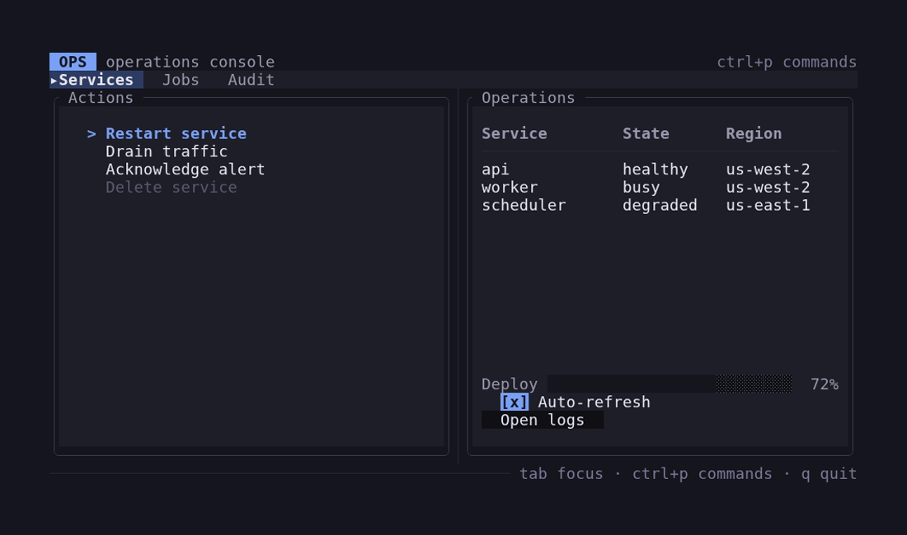</a> | **[browser](examples/browser)** · filterable files, preview, and scrollbars<br><a href="examples/browser">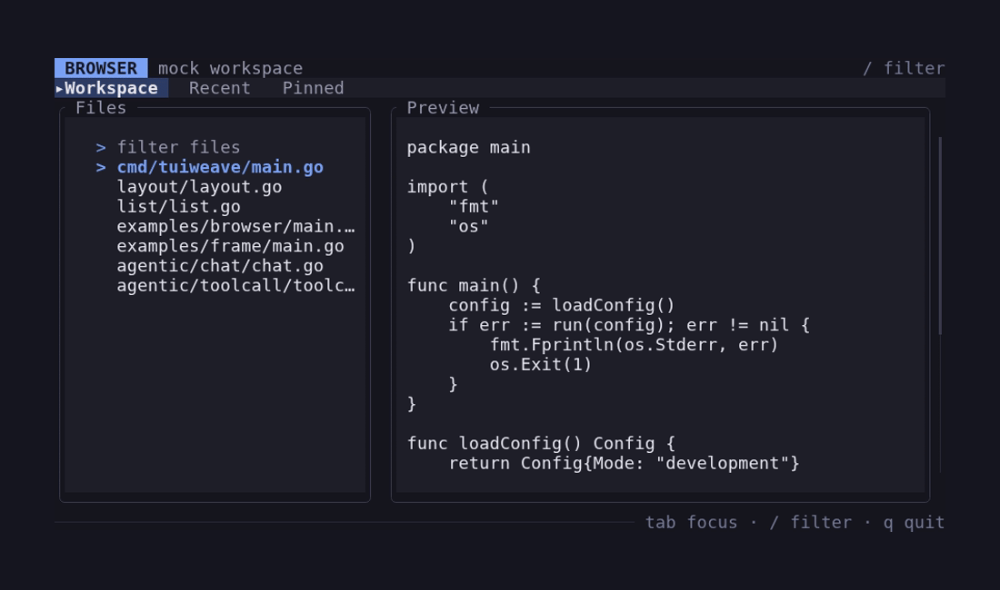</a> |
| **[chat](examples/chat)** · streaming agent transcript and permission prompt<br><a href="examples/chat">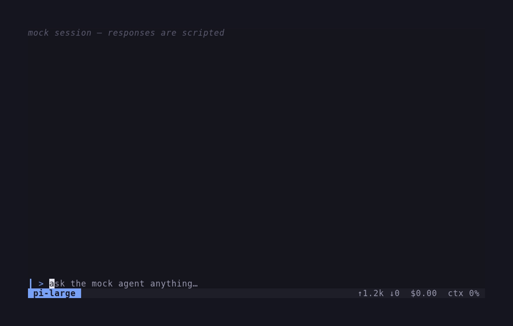</a> | **[demo](examples/demo)** · multi-pane layout with list, viewport, and dialog<br><a href="examples/demo">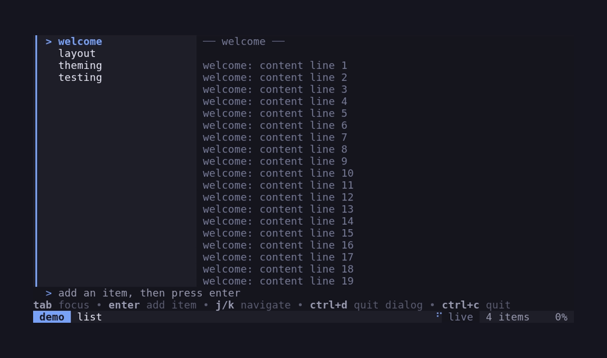</a> |
| **[frame](examples/frame)** · tabs, actions, toolbar, progress, toggle, button<br><a href="examples/frame">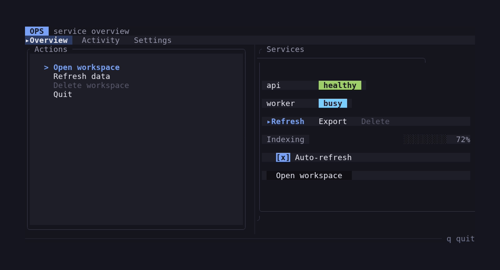</a> | **[table](examples/table)** · git-style table beside a diff pane<br><a href="examples/table">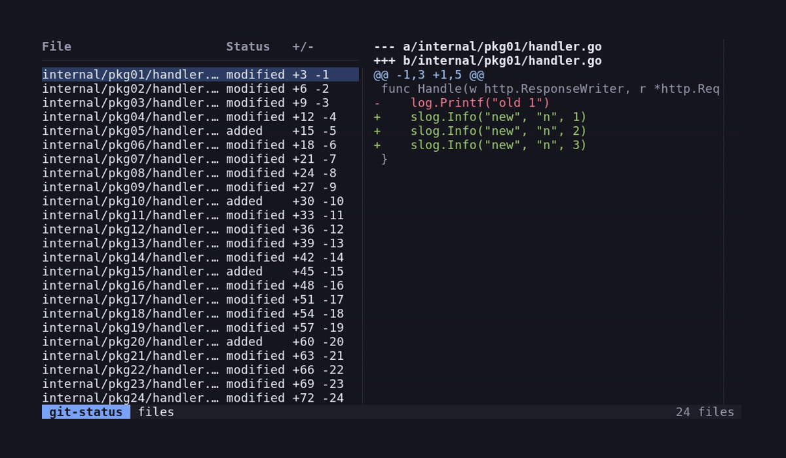</a> |
| **[statusbar](examples/statusbar)** · theme cycling and status segments<br><a href="examples/statusbar">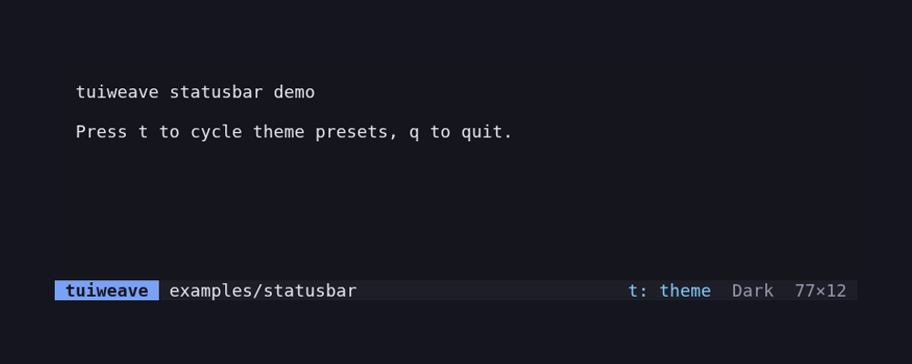</a> | **[consumer](examples/consumer)** · public-API consumer smoke app<br><a href="examples/consumer">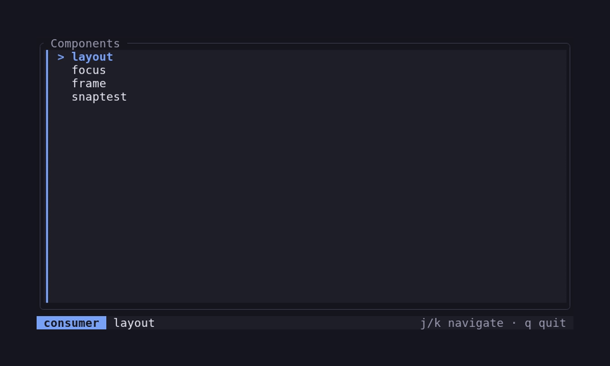</a> |
| **[autocomplete](examples/autocomplete)** · input plus suggestion window<br><a href="examples/autocomplete">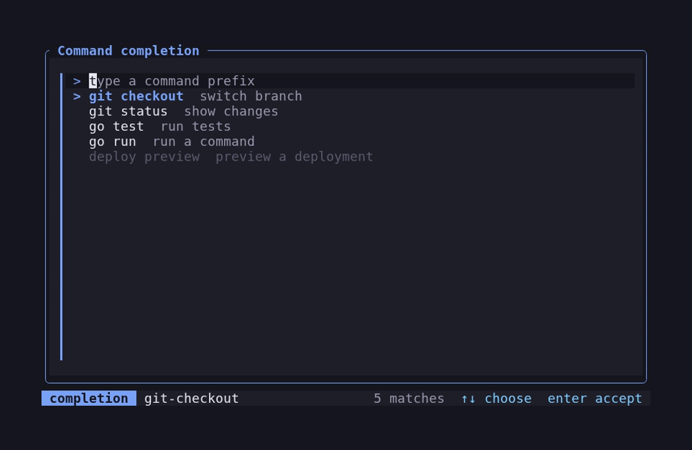</a> | **[textarea-autocomplete](examples/textarea-autocomplete)** · token completion in a textarea<br><a href="examples/textarea-autocomplete">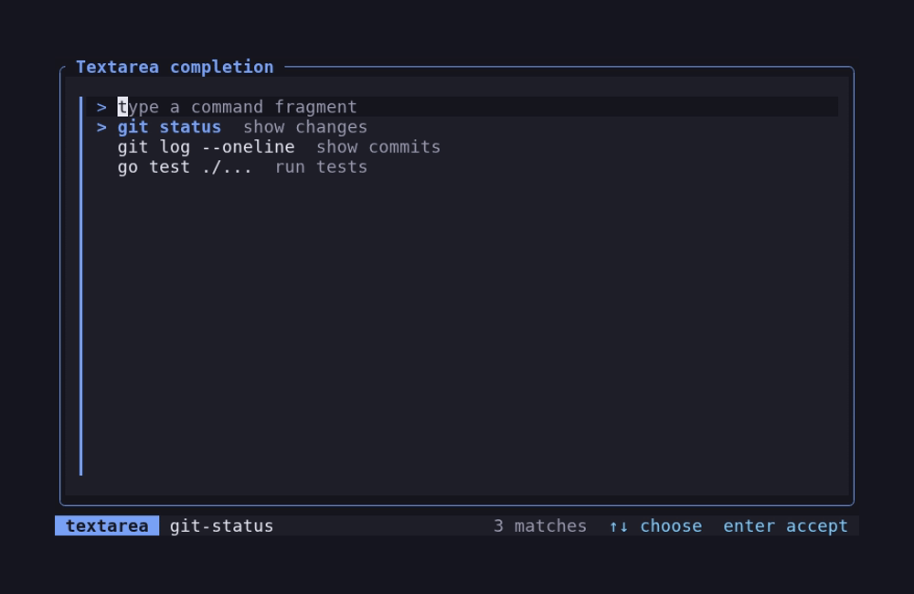</a> |
| **[palette](examples/palette)** · filtered command discovery and activation<br><a href="examples/palette">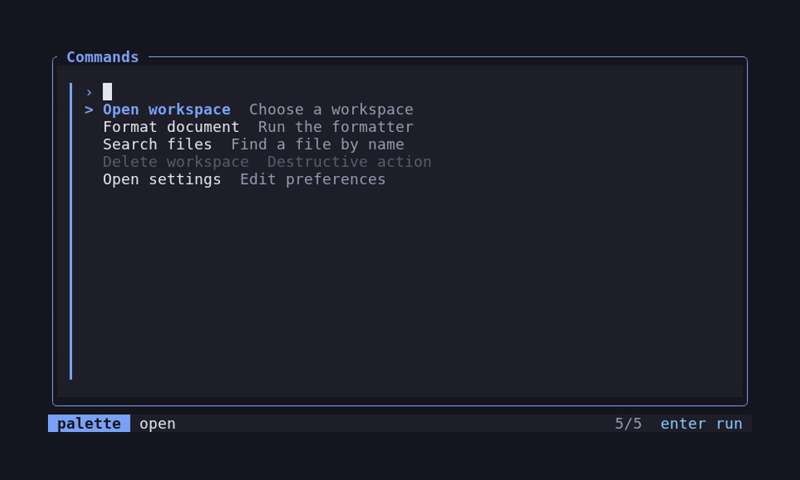</a> | **[form](examples/form)** · Huh-style stacked fields<br><a href="examples/form">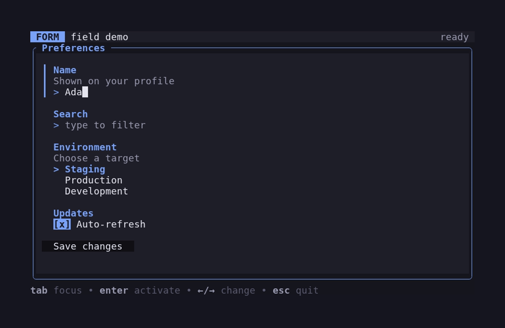</a> |
| **[inline](examples/inline)** · Clack-style inline prompts<br><a href="examples/inline">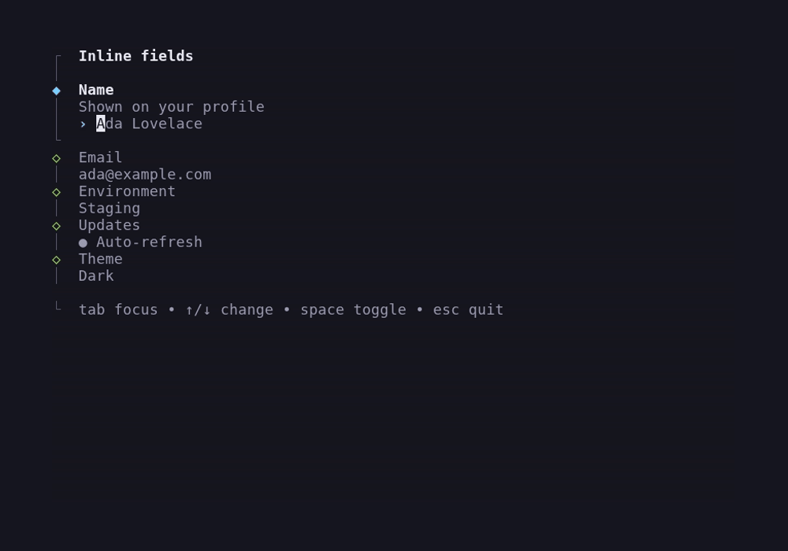</a> | **[banner](examples/banner)** · figlet gradient banner<br><a href="examples/banner">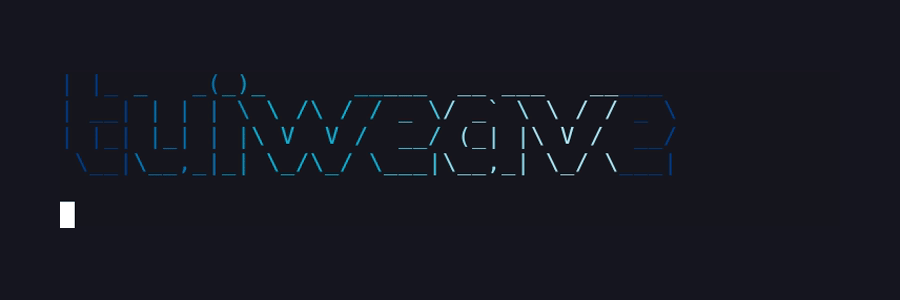</a> |


The root package supplies semantic theme roles. Domain-neutral components live
in top-level packages such as `layout`, `frame`, `tabs`, `menu`, `viewport`,
`textinput`, and `textarea`; optional domain packages live under `agentic/`.
The [agent catalog](AGENT-CATALOG.md) maps common tasks to packages and examples.

### Canonical non-agentic reference app

[`examples/ops`](examples/ops) is the complete non-agentic reference app. It
composes tabs, menus, tables, status controls, nested overlays, semantic
inspection, mouse routing, and deterministic interaction tests into a small
operations console:

```sh
go run ./examples/ops
```

Use `tab` and `shift+tab` to move focus, arrow keys to navigate the focused
component, `ctrl+p` to open the command palette, and `q` to quit. Mouse clicks
focus controls and select tabs, menu rows, or table rows; clicking the toggle
or button also emits its normal typed result command. While a palette or
confirmation is open, the application keeps background controls inert.

The example keeps ownership boundaries explicit:

| Concern | Owner in `examples/ops` |
|---|---|
| Layout and sizing | The app splits every window size into rectangles and calls each component's `SetSize`. |
| Focus | The app retains a `focus.Stack`, reapplies fresh component addresses, and restores the parent index after an overlay closes. |
| Mouse input | The app hit-tests its retained rectangles, then translates global clicks into local focus, selection, or activation. |
| Modal routing | The app owns visibility and sends input only to the top visible layer; `overlay` only composites rendered strings. |
| Commands and side effects | Components emit typed messages; the app handles delivered results and owns the resulting notice/state change. |
| Semantic actions | The app assembles absolute inspection bounds, validates visible enabled actions, and forwards only the local action suffix. |

The layout intentionally has a narrow-terminal fallback, and its important
focus, modal, mouse, command-delivery, semantic-routing, and narrow states are
captured as readable and role-aware goldens:

```sh
go test ./examples/ops
```

Read [`examples/ops/main.go`](examples/ops/main.go) for the application wiring
and [`examples/ops/main_test.go`](examples/ops/main_test.go) for the snapshot and
scenario workflow. [`examples/consumer`](examples/consumer) remains the smaller
public-API smoke example, while the other runnable examples continue to teach
individual packages.

### Start with five packages

For a small interactive application, start with `layout`, `focus`, `frame`, one
interaction component such as `list` or `textarea`, and `snaptest`. Add
`inspect` when the application needs machine-readable state or semantic actions.

### Package guides

Foundations and composition:
[`action`](action), [`banner`](banner), [`focus`](focus), [`frame`](frame), [`inspect`](inspect),
[`layout`](layout), [`line`](line), [`mouse`](mouse), [`overlay`](overlay),
[`scrollbar`](scrollbar), [`snaptest`](snaptest), [`splitpane`](splitpane), and
[`stack`](stack).

General-purpose components:
[`autocomplete`](autocomplete), [`button`](button), [`dialog`](dialog),
[`help`](help), [`list`](list), [`menu`](menu), [`palette`](palette),
[`progress`](progress), [`spinner`](spinner), [`statusbar`](statusbar),
[`table`](table), [`tabs`](tabs), [`textarea`](textarea),
[`textinput`](textinput), [`toggle`](toggle), [`toolbar`](toolbar), and
[`viewport`](viewport).

Agentic domain components:
[`chat`](agentic/chat), [`diffview`](agentic/diffview),
[`markdown`](agentic/markdown), [`permission`](agentic/permission),
[`toolcall`](agentic/toolcall), and [`usagebar`](agentic/usagebar).

Eight built-in theme presets are available through `tuiweave.Presets()` and
`tuiweave.ThemeForPreset(id)`. Named constructors such as `Dark()`, `Nord()`,
and `CatppuccinLatte()` are convenient when an app does not need discovery.
Components derive styles when constructed, so an app that changes themes
reconstructs its components from the newly selected `Theme` while preserving
application-owned state. See [`examples/statusbar`](examples/statusbar).

An app can make a semantic surface inherit the terminal or parent background
by assigning `lipgloss.NoColor{}` to that role on a copy of its theme:

```go
theme := tuiweave.Dark()
theme.SurfaceRaised = lipgloss.NoColor{}
```

Components constructed with that derived theme omit the raised background
while selection, accent, and intent fills keep their normal semantic roles.
This is the supported selective styling pattern; component internals remain
encapsulated.

## API highlights

- `Theme` defines the semantic roles consumed by every themed component.
- `Dark`, `Light`, `Nord`, and other named constructors provide fixed themes.
- `Presets` and `ThemeForPreset` support application-owned theme selection.
- Derived themes can use `lipgloss.NoColor{}` when a role should inherit its
  surrounding color.

## Related documentation

- [API reference](https://pkg.go.dev/github.com/ishan5ain/tuiweave)
- [Architecture](DESIGN.md)
- [Compatibility and migration policy](COMPATIBILITY.md)
- [Dependency architecture](DESIGN.md#6-dependency-policy)
- [v1 readiness checklist](V1-READINESS.md)
- [Agent catalog](AGENT-CATALOG.md)
- [Authoring conventions](AGENTS.md)
- [Agent kit](agent-kit/README.md) — app workflows, skill package, templates, and audit

## Development

```sh
gofmt -w .
go mod tidy -diff
go mod verify
go build ./...
go vet ./...
go test ./...
go test -race ./...
govulncheck ./...
./scripts/agent-kit-verify.sh
```

Rendering changes require intentional snapshot review; see [AGENTS.md](AGENTS.md).

## Known limitations

- The API is pre-v1 and may evolve between minor versions.
- Input-method editor behavior is incomplete.
- Components currently target Bubble Tea v2.
- Layout and rendering internals rely on a pre-v1 Ultraviolet dependency.

Licensed under the [MIT License](LICENSE).
